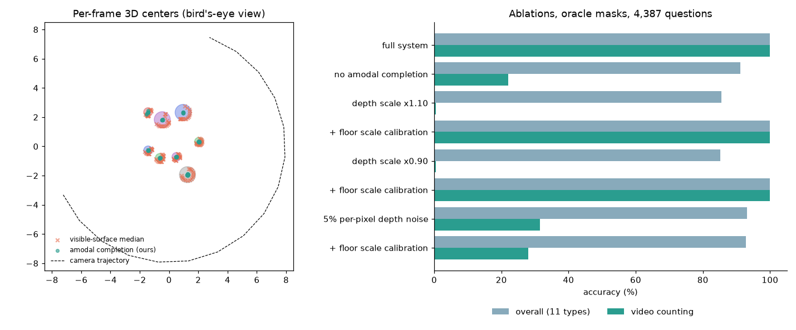

# 3D Scene-Graph Spatial Reasoner

[](https://github.com/selfishout/scene-graph-spatial-reasoner/actions/workflows/tests.yml)


**Counting and relational reasoning about 3D objects by lifting 2D perception into a metric 3D scene graph, for
single images and multi-frame video.**

End-to-end VLMs remain weak at metric and cross-view spatial reasoning. On
[spatial-scene-bench](https://github.com/selfishout/spatial-scene-bench), Qwen2.5-VL-3B scores 24% on video counting
and about 0 MRA on 3D distance. This project takes the explicit route used by SpatialRGPT, SpatialVLM-style data
engines and 3D-LLMs: perceive, lift to 3D, build a scene graph, then reason over it symbolically or by prompting an
LLM with the graph.

```
RGB ──► Grounding DINO (open-vocab boxes) ──► SAM (masks) ──┐
   └──► Depth Anything V2 Metric (depth) ───────────────────┼──► back-projection ──► amodal 3D objects
camera K, pose (or RANSAC floor → gravity frame) ───────────┘            │
                                                                         ▼
                           multi-view fusion (video) ◄── per-frame objects ──► 3D scene graph
                                                                                  │
                                       neuro-symbolic solver  ◄───────────────────┤
                                       graph-prompted LLM / VLM  ◄────────────────┘
```

## Components

| Module | What it does |
| --- | --- |
| `lifting.py` | back-projection, **amodal footprint completion** of partially seen objects, RANSAC floor plane, gravity-aligned frame for images without extrinsics, **floor-based depth-scale calibration**, multi-view **3D fusion** for counting each physical object once |
| `perception.py` | `FoundationBackend`: Grounding DINO, SAM, Depth Anything V2 Metric and attribute heuristics (hue-based color, 3D-extent-based size, highlight-based material). `OracleBackend`: rendered masks + depth from the benchmark, with optional depth corruption to emulate monocular estimators |
| `graph.py` | scene graph with viewer-centric relations (left/right/front/behind), metric distances, egocentric quadrants, text serialization |
| `solver.py` | parses questions into small programs (`count`, `filter`, `relate`, `closest`, `distance`, `ego`) and executes them on the graph |
| `llm.py` | scene-graph prompting for free-form questions through any OpenAI-compatible endpoint, optionally with the image |
| `run_bench.py` | evaluation and ablations on spatial-scene-bench |

## Results and ablations

All experiments use 4,387 questions over 200 scenes generated with `ssb-generate --num-scenes 200 --seed 2025`.
In oracle mode, instance masks and depth come from the renderer, but **object positions are never read from ground
truth**. They are re-estimated from depth, so these runs isolate the 3D lifting, fusion and reasoning stages from
detection errors.



| Setting | Overall | Video count | Distance (MRA) | Video distance (MRA) |
| --- | ---: | ---: | ---: | ---: |
| Full system (amodal completion + 3D fusion) | **100.0** | **100.0** | 99.7 | 100.0 |
| Visible-surface median instead of amodal completion | 91.2 | 22.0 | 95.6 | 88.2 |
| Depth scale ×1.10 | 85.5 | 0.5 | 85.8 | 70.6 |
| Depth scale ×1.10 + floor scale calibration | **100.0** | **100.0** | 99.7 | 100.0 |
| Depth scale ×0.90 | 85.2 | 0.5 | 83.9 | 63.5 |
| Depth scale ×0.90 + floor scale calibration | **100.0** | **100.0** | 99.7 | 100.0 |
| 5% i.i.d. per-pixel depth noise | 93.2 | 31.5 | 97.6 | 96.7 |
| 5% noise + floor scale calibration | 92.8 | 28.0 | 97.7 | 96.3 |

| Video counting strategy (full system) | Accuracy |
| --- | ---: |
| 3D fusion across frames | **100.0** |
| Best single frame | 99.8 |
| Sum of per-frame counts | 0.5 |

Takeaways:

1. **Amodal completion is essential for multi-view consistency.** The median of the visible surface is biased toward
   each camera by up to a full object radius, in a different direction for every frame, so the same object fails to
   merge across views. Mean center error drops from 43 cm to 2 cm on a test scene, and video counting goes from 22%
   to 100%.
2. **Single-view relations are robust to depth-scale errors, but cross-view fusion is not.** A 10% global scale
   error, typical for monocular metric depth, leaves viewer-centric relations at 100% but collapses video counting.
   Using the known camera height to calibrate each frame's scale against the fitted floor plane recovers it fully.
3. **Open problem:** high-frequency depth noise still inflates object extents and breaks fusion (31.5%). Robust
   per-object surface fitting is next.
4. In these orbit videos the best single frame usually sees every object, which is why "best single frame" is nearly
   as good as fusion. The room-scale mode planned in spatial-scene-bench is meant to separate the two.

Reproduce:

```bash
pip install -e ".[dev]"
ssb-generate --out data/ssb --num-scenes 200 --video-frames 16 --seed 2025
sgr-bench --data data/ssb                                  # full system
sgr-bench --data data/ssb --no-center-correction
sgr-bench --data data/ssb --depth-scale 1.10 --scale-calibration
sgr-bench --data data/ssb --types video_count --video-count-mode sum
```

## Real images (foundation-model perception)

```python
from PIL import Image
from sgreasoner.perception import FoundationBackend
from sgreasoner.graph import SceneGraph
from sgreasoner.solver import Solver

backend = FoundationBackend(vocabulary=("sphere", "cube", "cylinder"))
objs, K, T = backend.observe(Image.open("scene.png"))     # no pose: the floor plane defines a gravity frame
graph = SceneGraph(objs, K, T)
print(graph.to_text())
print(Solver(graph).answer("How many cubes are to the left of the red sphere?"))
```

`pip install -e ".[foundation]"` installs the extra dependencies. Model IDs are configurable. This path works but is
**experimental**; benchmark numbers with learned perception are on the roadmap.

## Roadmap

- [ ] Report foundation-perception results on spatial-scene-bench and on real data (ScanNet / ARKitScenes questions
      from VSI-Bench)
- [ ] Camera poses and dense geometry from [VGGT](https://github.com/facebookresearch/vggt) or
      [MoGe](https://github.com/microsoft/MoGe) for unposed video
- [ ] Track-aware fusion with [Grounded-SAM-2](https://github.com/IDEA-Research/Grounded-SAM-2) for counting under heavy occlusion
- [ ] Graph-prompted Qwen2.5-VL vs. image-only prompting; use solver traces as process rewards in
      [spatial-r1-vlm](https://github.com/selfishout/spatial-r1-vlm)

## Related work

[SpatialRGPT](https://github.com/AnjieCheng/SpatialRGPT) ·
[SpatialBot](https://github.com/BAAI-DCAI/SpatialBot) ·
[3D-LLM](https://github.com/UMass-Embodied-AGI/3D-LLM) ·
[Chat-Scene](https://github.com/ZzZZCHS/Chat-Scene) ·
[LLaVA-3D](https://github.com/ZCMax/LLaVA-3D) ·
[Video-3D LLM](https://github.com/LaVi-Lab/Video-3D-LLM) ·
[SpatialLM](https://github.com/manycore-research/SpatialLM) ·
[Grounding DINO](https://github.com/IDEA-Research/GroundingDINO) ·
[SAM 2](https://github.com/facebookresearch/sam2) ·
[Depth Anything V2](https://github.com/DepthAnything/Depth-Anything-V2) ·
[Depth Pro](https://github.com/apple-aiml-research/ml-depth-pro) ·
[CountGD](https://github.com/niki-amini-naieni/CountGD)

## License

MIT
